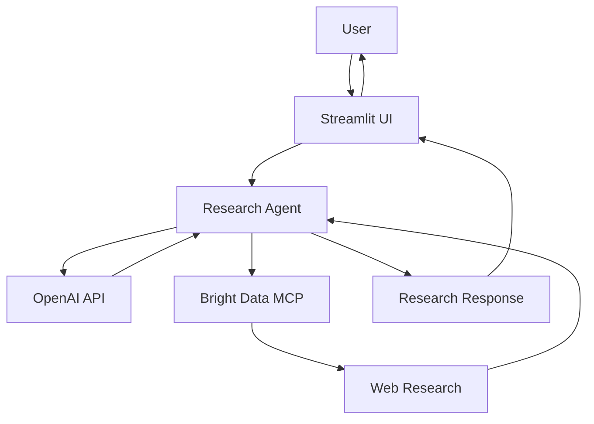
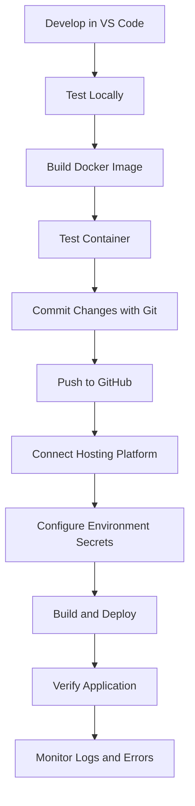

# 🔎 Bright Data Research Agent

An AI-powered web research application that combines **Bright Data**, **OpenAI**, and **Streamlit** to help users research topics using web data and generate AI-assisted responses.

The project demonstrates how to integrate web research tools with an AI agent, build an interactive user interface, and package the application using Docker for consistent deployment.

## 🚀 Project Overview

The Bright Data Research Agent follows a workflow in which a user submits a research query, the application gathers relevant web information, and an AI model uses the available research to generate a response.

### Key Features

- **AI-powered research:** Uses OpenAI to interpret research queries and generate responses.
- **Web research integration:** Connects to Bright Data MCP to access web research capabilities.
- **Interactive UI:** Provides a browser-based interface using Streamlit.
- **Containerization:** Packages the application and its dependencies into a Docker image.
- **Environment-based configuration:** Keeps API credentials outside the application source code.
- **Local development:** Supports development and testing on a local machine.
- **Cloud deployment readiness:** Uses Git and GitHub to support source control and deployment workflows.

## 🏗️ Architecture



*Note: The exact interaction sequence depends on the implementation in `app.py` and `research_agent.py`.*

## 🔄 End-to-End Workflow

1. **User input:** The user enters a research question in the Streamlit application.
2. **Request processing:** The application passes the query to the research agent.
3. **Web research:** The agent uses Bright Data MCP to access relevant web information.
4. **AI analysis:** OpenAI helps interpret the research and formulate a response.
5. **Response generation:** The agent returns the generated research output to the application.
6. **User presentation:** Streamlit displays the response in the browser.

## 🧰 Technology Stack

| Technology | Purpose |
|---|---|
| Python | Core application logic |
| Streamlit | Web user interface |
| OpenAI API | AI-powered reasoning and response generation |
| Bright Data MCP | Web research and data access |
| Model Context Protocol (MCP) | Standardized integration between AI applications and tools |
| Docker | Application containerization |
| Git | Version control |
| GitHub | Source code hosting and collaboration |

## 📁 Project Structure

```text
MCP---brightdata-research-agent/
├── app.py                 # Streamlit user interface
├── research_agent.py      # Research agent logic
├── search_web.py          # Web search-related functionality
├── test_brightdata.py     # Bright Data testing
├── requirements.txt       # Python dependencies
├── Dockerfile             # Docker image configuration
├── .dockerignore          # Files excluded from Docker builds
├── .gitignore             # Files excluded from Git
└── README.md              # Project documentation
```

## ⚙️ Prerequisites

Before running the project, install:

- Python 3.13
- Docker Desktop
- Git
- A Bright Data API token
- An OpenAI API key

## 🖥️ Run Locally

### 1. Clone the repository

```bash
git clone https://github.com/sheetalrd/MCP---brightdata-research-agent.git
cd MCP---brightdata-research-agent
```

### 2. Create and activate a virtual environment

```bash
python -m venv .venv
```

On Windows PowerShell:

```powershell
.\.venv\Scripts\Activate.ps1
```

### 3. Install dependencies

```bash
pip install -r requirements.txt
```

### 4. Configure environment variables

Create a `.env` file in the project root:

```dotenv
BRIGHTDATA_API_TOKEN=your_brightdata_api_token
OPENAI_API_KEY=your_openai_api_key
```

Replace the placeholders with your own credentials. Never commit `.env` or expose API keys in source code.

### 5. Start the application

```bash
streamlit run app.py
```

Open the local URL displayed in the terminal, usually:

`http://localhost:8501`

## 🐳 Run with Docker

Docker packages the application and its dependencies into an image, helping ensure a consistent runtime environment.

### 1. Build the Docker image

Run this command from the project root:

```bash
docker build -t brightdata-research-agent .
```

### 2. Start the container

```bash
docker run -d --name brightdata-research-agent -p 8501:8501 --env-file .env brightdata-research-agent
```

### 3. Open the application

Visit:

`http://localhost:8501`

### 4. Manage the container

View running containers:

```bash
docker ps
```

View application logs:

```bash
docker logs brightdata-research-agent
```

Stop the container:

```bash
docker stop brightdata-research-agent
```

Start it again:

```bash
docker start brightdata-research-agent
```

Remove the container when it is no longer needed:

```bash
docker rm -f brightdata-research-agent
```

## ☁️ Deployment Workflow

The project can be developed locally, version-controlled through GitHub, and deployed to a suitable cloud hosting platform.



### Deployment stages

1. **Development:** Make code changes in VS Code.
2. **Testing:** Verify the application locally.
3. **Containerization:** Build and test the Docker image.
4. **Version control:** Commit changes and push them to GitHub.
5. **Cloud configuration:** Configure the hosting platform and securely supply required environment variables.
6. **Deployment:** Build and run the application in the cloud.
7. **Verification:** Check application availability, API connectivity, logs, and error handling.
8. **Maintenance:** Fix issues, update dependencies, and redeploy tested changes.

**Hosting note:** Choose a platform that supports the application's Streamlit runtime and required container behavior. Render or a suitable container service is worth evaluating for this Docker-based application. Confirm the selected platform's current runtime, port, and deployment requirements before deploying.

## 🔐 Security Best Practices

- Never commit `.env`, API keys, or other credentials.
- Keep `.env` listed in `.gitignore` and `.dockerignore`.
- Configure production secrets through the hosting platform's secret or environment-variable settings.
- Use least-privilege credentials wherever possible.
- Avoid logging API keys, sensitive research inputs, or confidential responses.
- Review dependencies regularly and rebuild images after security updates.
- Keep the GitHub repository private if the code or configuration is not intended for public distribution.

## 🧪 Testing and Troubleshooting

If the application does not start:

1. Check that the virtual environment is activated and dependencies are installed.
2. Verify that the required environment variables are configured without sharing their values.
3. Review the terminal output or Docker logs.
4. Check whether port `8501` is already in use.
5. Confirm that Docker Desktop is running when using containers.

## 🎯 Learning Objectives

This project demonstrates practical experience with:

- AI agent development and API integration
- Model Context Protocol (MCP)
- Web research integration
- Python application development
- Streamlit user interfaces
- Docker images and containers
- Git and GitHub workflows
- Environment configuration and secret management
- Container-based deployment concepts

## 🛣️ Potential Future Enhancements

- Add structured citations and source links to research responses.
- Improve error handling, retries, and API timeout management.
- Add automated unit and integration tests.
- Introduce application logging and observability.
- Add CI/CD automation for testing and deployment.
- Add authentication and access controls where required.
- Track latency, token usage, and research costs.

## 📄 License

No license has been specified yet. Add a suitable license file before distributing the project as open-source software.

---

**Built as a hands-on project to explore AI agents, Bright Data MCP, and containerized application deployment.**
